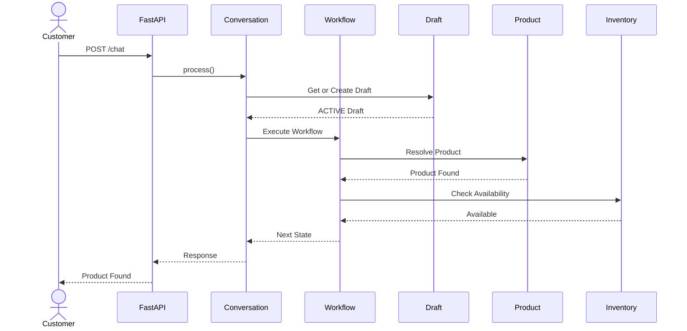
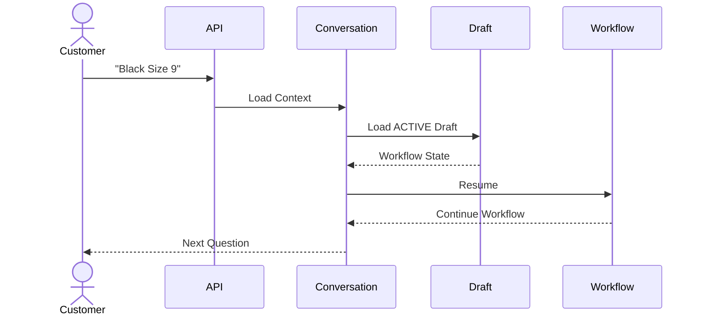
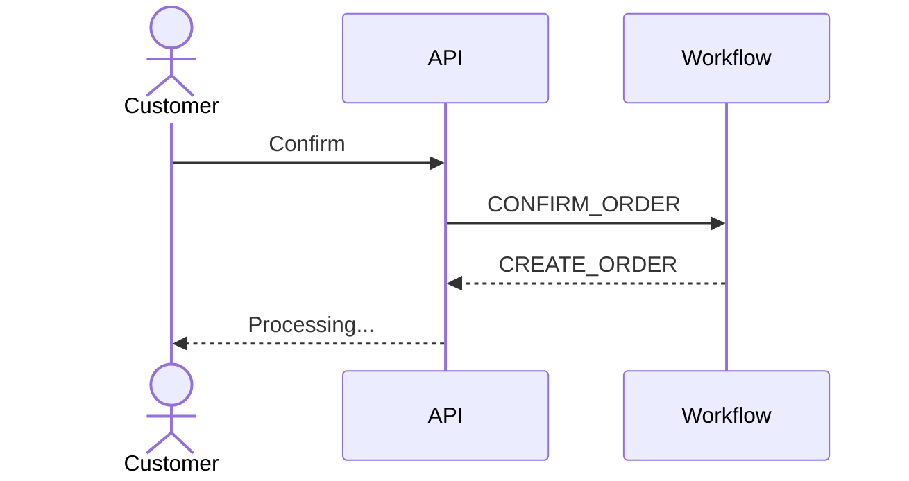
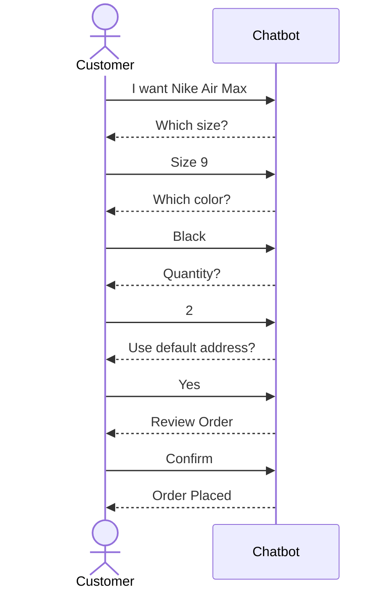

# Sequence Diagrams

## Purpose

This document describes the runtime interactions between the major components of the Order Automation Chatbot.

While previous documents describe the architecture and domain model, this document focuses on **how requests flow through the system**.

The diagrams illustrate component interactions during the most common customer journeys.

---

# Components

The following components appear throughout the sequence diagrams.

| Component | Responsibility |
|-----------|----------------|
| Customer | Sends conversational messages |
| FastAPI | Receives HTTP requests |
| Conversation Service | Loads conversation state |
| Workflow Engine | Executes workflow handlers |
| Workflow Handler | Executes one workflow state |
| Business Service | Performs domain operations |
| Repository | Persists data |
| PostgreSQL | Stores data |

---

# Scenario 1 — Place a New Order

## Description

A customer starts a new conversation and places an order from scratch.



---

# Scenario 2 — Resume Existing Draft

## Description

The customer already has an ACTIVE draft.

The conversation resumes from the stored workflow state.



---

# Scenario 3 — Product Resolution

## Description

The workflow resolves a product name extracted from natural language.

```mermaid
sequenceDiagram

actor Customer

participant Workflow
participant ProductService
participant ProductRepository
participant Database

Customer->>Workflow: Nike Air Max

Workflow->>ProductService: Resolve Product

ProductService->>ProductRepository: find_by_name()

ProductRepository->>Database: SELECT Product

Database-->>ProductRepository: Product

ProductRepository-->>ProductService

ProductService-->>Workflow

Workflow-->>Customer: Product Found
```

---

# Scenario 4 — Inventory Validation

## Description

The workflow verifies stock before checkout.

```mermaid
sequenceDiagram

participant Workflow
participant InventoryService
participant InventoryRepository
participant PostgreSQL

Workflow->>InventoryService: Check Stock

InventoryService->>InventoryRepository: Get Inventory

InventoryRepository->>PostgreSQL: SELECT Inventory

PostgreSQL-->>InventoryRepository

InventoryRepository-->>InventoryService

InventoryService-->>Workflow: Available
```

---

# Scenario 5 — Pricing Calculation

## Description

The pricing engine calculates the final payable amount.

```mermaid
sequenceDiagram

participant Workflow

participant PricingService

participant Draft

Workflow->>Draft: Load Draft

Draft-->>Workflow

Workflow->>PricingService: Calculate Pricing

PricingService-->>Workflow: Pricing Summary

Workflow-->>Customer: Order Review
```

---

# Scenario 6 — Customer Confirmation

## Description

The customer approves the order.



---

# Scenario 7 — Checkout Transaction

## Description

The Order Orchestrator converts the Draft into an Order.

```mermaid
sequenceDiagram

participant Workflow

participant Orchestrator

participant Inventory

participant Order

participant Payment

participant Shipment

participant Draft

Workflow->>Orchestrator: Checkout

Orchestrator->>Inventory: Reserve Stock

Inventory-->>Orchestrator

Orchestrator->>Order: Create Order

Order-->>Orchestrator

Orchestrator->>Payment: Create Payment

Payment-->>Orchestrator

Orchestrator->>Shipment: Create Shipment

Shipment-->>Orchestrator

Orchestrator->>Draft: Complete Draft

Draft-->>Orchestrator

Orchestrator-->>Workflow: Order Created
```

---

# Scenario 8 — Transaction Rollback

## Description

A failure occurs during checkout.

```mermaid
sequenceDiagram

participant Orchestrator

participant Inventory

participant Order

participant Payment

Orchestrator->>Inventory: Reserve Stock

Inventory-->>Orchestrator

Orchestrator->>Order: Create Order

Order-->>Orchestrator

Orchestrator->>Payment: Create Payment

Payment--xOrchestrator: Failure

Orchestrator->>Database: ROLLBACK

Database-->>Orchestrator

Orchestrator-->>Workflow: Checkout Failed
```

---

# Scenario 9 — Restart Order

## Description

The customer starts a completely different order while another draft is still active.

```mermaid
sequenceDiagram

actor Customer

participant Conversation

participant Draft

participant Workflow

Customer->>Conversation: I want an iPhone

Conversation->>Draft: Load ACTIVE Draft

Draft-->>Conversation

Conversation->>Conversation: Draft Resolution Policy

Conversation->>Draft: Mark Previous Draft ABANDONED

Conversation->>Draft: Create New Draft

Draft-->>Conversation

Conversation->>Workflow: DETECT_INTENT

Workflow-->>Customer: Let's start your new order.
```

---

# Scenario 10 — Complete Conversation



---

# Summary

These sequence diagrams describe the runtime behavior of the system and complement the architectural documentation.

Together they illustrate:

- Request flow
- Workflow execution
- Draft management
- Product resolution
- Inventory validation
- Pricing calculation
- Checkout orchestration
- Transaction rollback
- Draft restart policy
- Complete conversational ordering